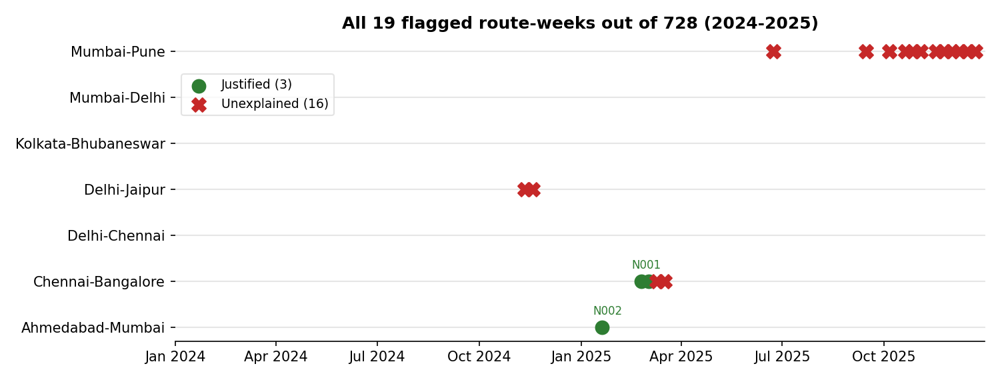
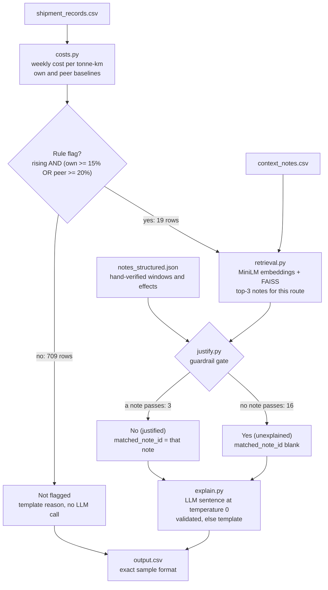
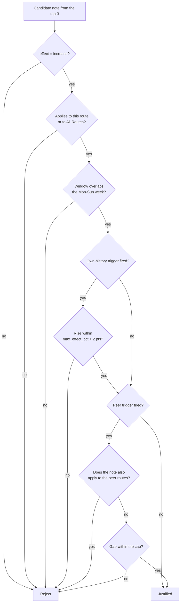
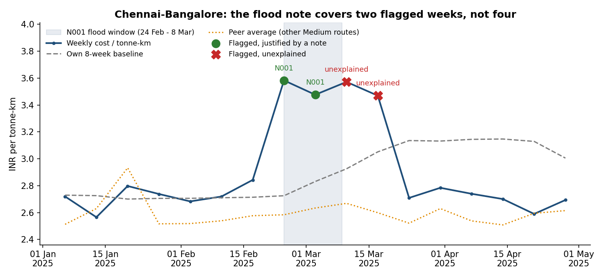
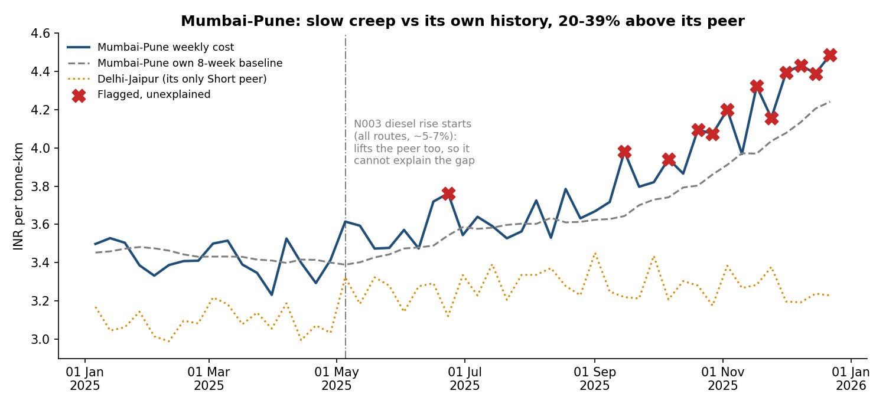

# freight-cost-watch

A small assistant that watches freight costs. It tracks cost per tonne-km for every route,
week by week, flags weeks where cost is rising in a way that looks out of the ordinary, checks
a set of context notes for a genuine reason, and explains each verdict in plain English.

Numbers and verdicts are fully deterministic. The LLM only words the explanations; it can
never change a verdict or choose which note is cited.

**Result on the provided data:** 728 route-weeks, 19 flagged → **3 justified, 16 unexplained**.



---

## Contents

1. [Quick start](#quick-start)
2. [How it works](#how-it-works)
3. [Core numbers](#core-numbers)
4. [Flag rule and thresholds](#flag-rule-and-thresholds)
5. [Notes, retrieval and the justification gate](#notes-retrieval-and-the-justification-gate)
6. [Two cases worth looking at](#two-cases-worth-looking-at)
7. [Explanations and the LLM](#explanations-and-the-llm)
8. [Asking questions about the results](#asking-questions-about-the-results)
9. [How the results were verified](#how-the-results-were-verified)
10. [Reproducibility](#reproducibility)
11. [Token and cost log](#token-and-cost-log)
12. [Trade-offs and limitations](#trade-offs-and-limitations)
13. [Project layout](#project-layout)

---

## Quick start

Python 3.12 is recommended (all dependencies have ready-made wheels for it).

**Windows (PowerShell)**

```powershell
py -3.12 -m venv .venv
.venv\Scripts\Activate.ps1
pip install torch --index-url https://download.pytorch.org/whl/cpu
pip install -r requirements.txt

python -m pytest -q                      # 56 tests
python run.py --no-llm                   # templates only, zero LLM calls
$env:GROQ_API_KEY="gsk_..."; python run.py   # LLM explanations via Groq
python eval/score.py                     # gold labels + guardrail audit
python ask.py "why did this route get pricier in March?"
```

**macOS / Linux**

```bash
python3.12 -m venv .venv && source .venv/bin/activate
pip install torch --index-url https://download.pytorch.org/whl/cpu
pip install -r requirements.txt
python -m pytest -q
GROQ_API_KEY=gsk_... python run.py
./repro_check.sh                         # 3 fresh runs, diff all columns except reason
```

On Windows, run `repro_check.sh` from Git Bash. `python run.py --llm ollama` uses a local
model instead of Groq.

---

## How it works



| Module | Responsibility |
|---|---|
| `fcw/costs.py` | Grouping, weekly cost, baselines, flag rule (pandas, no AI) |
| `fcw/notes.py` | Joins note text with hand-verified structure; consistency checks |
| `fcw/retrieval.py` | Embeds notes into a FAISS index; top-k search with a route filter |
| `fcw/justify.py` | The guardrail gate: decides justified vs unexplained |
| `fcw/explain.py` | Prompt, output validator, template fallback |
| `fcw/llm.py` | Groq / Ollama clients (stdlib HTTP), token and cost ledger |
| `fcw/output.py` | Column contract, string formats, ASCII normalisation |
| `fcw/qa.py`, `ask.py` | Question answering over `output.csv` |
| `fcw/config.py` | Every threshold and setting |

---

## Core numbers

- **route** = `origin-destination` (whitespace stripped); `route_type` is used as given.
  Rows are grouped by `(route, route_type, week_of)`.
- **week_of** = `shipment_date − weekday`, i.e. the Monday of that week, as an ISO date.
- **cost_per_tonne_km** = `Σ freight_cost_inr / Σ (quantity_tonnes × distance_km)` per
  route-week. This is tonne-km weighted. Averaging per-shipment ratios would let one small
  load swing the week, and it does not reproduce the sample.
- **vs own history** = mean of the previous 8 weekly values,
  `shift(1).rolling(8, min_periods=1).mean()`, so the current week is never included. The
  series is first reindexed onto a full weekly calendar, so a missing week would count as a
  week instead of silently stretching the window. This dataset has no gaps (7 routes × 104
  weeks).
- **vs similar routes** = simple mean of the weekly cost of the *other* routes with the same
  `route_type` in the same week. The route itself is excluded.
- Percentages are `(cost / baseline − 1) × 100` on unrounded values. Rounding happens only
  when formatting (2 dp for cost, 1 dp for percentages).

All three sample rows reproduce character for character on every column except `reason`:

| route | week_of | cost | vs own | vs similar | flagged | note |
|---|---|---|---|---|---|---|
| Delhi-Jaipur | 2024-11-11 | 4.17 | +35.5% | +21.0% | Yes | |
| Ahmedabad-Mumbai | 2025-01-20 | 3.29 | +29.5% | +22.5% | No (justified) | N002 |
| Mumbai-Pune | 2025-09-15 | 3.98 | +9.2% | +23.6% | Yes | |

**Fewer than 8 prior weeks.** Each route's first week has no history, so `vs_own_history` is
`N/A` and the row can't be flagged (there is nothing to be *rising* against). Weeks 2-8 of
each route (49 route-weeks) use all the prior weeks available, 1 to 7, never padded or
extrapolated. Their `reason` says how many weeks the baseline used.

---

## Flag rule and thresholds

```
flagged  ⇔  vs_own > 0  AND  (vs_own ≥ 15%  OR  vs_peer ≥ 20%)
```

Both thresholds live in `fcw/config.py`.

- **Rising is required.** The brief asks for cost that is *rising*. A route that is
  permanently pricier than its peers but flat against its own history is not flagged
  (e.g. Mumbai-Pune 2025-11-10: +21.4% vs peers, −0.1% vs own history).
- **15% vs own history.** Week-to-week noise is small: across all route-weeks, `vs_own` has
  a standard deviation of 4.2% and a 99th percentile of 11.1%. 15% is a clear outlier.
- **20% vs peers.** Peer gaps are naturally noisier (standard deviation 9.0%), and the Short
  class has only two routes, so its "average" is a single other route. The bar is higher.
  This branch catches the slow creep the brief describes (see Mumbai-Pune below).

**Sensitivity** (number of flagged route-weeks):

| own threshold ↓ / peer threshold → | 15% | 20% | 25% | 30% |
|---|---|---|---|---|
| 10% | 27 | 20 | 14 | 13 |
| **15%** | 26 | **19** | 13 | 12 |
| 20% | 26 | 19 | 13 | 12 |

The own threshold barely matters between 10% and 20%. The peer threshold does:

- At **25%**, the sample's Mumbai-Pune 2025-09-15 row (+23.6%, required `Yes`) would drop out.
- At **15%**, seven extra weeks would be flagged. All of them rose only 2-5% against their
  own history, and four are isolated weeks scattered through 2024-25: noise, not a trend.

---

## Notes, retrieval and the justification gate

### Structured notes

`data/notes_structured.json` gives each note hand-written fields: `routes`, `window_start`,
`window_end`, `effect ∈ {increase, no_effect, decrease}` and `max_effect_pct`. A `basis`
field quotes the note text behind each choice, so every field can be re-checked against the
original. These fields are written by hand, not inferred by an LLM. `notes.py` refuses to run
if ids, routes or dates disagree with `context_notes.csv`.

Only three notes describe a cost increase:

| Note | Route | Window | Effect |
|---|---|---|---|
| N001 | Chennai-Bangalore | 2025-02-24 to 2025-03-08 | increase (flood detours) |
| N002 | Ahmedabad-Mumbai | 2025-01-20 to 2025-01-26 | increase (festival surcharge) |
| N003 | All Routes | from 2025-05-05, open-ended | increase, ~5-7% (diesel) |

N004-N010 are `no_effect` or `decrease` and can never justify a flag.

### Retrieval

Note text, with its route and date, is embedded with `sentence-transformers/all-MiniLM-L6-v2`
into a FAISS `IndexFlatIP` (exact cosine search). For each flagged row, the query is the
route, the week and the month.

- **Route filter.** Notes for other routes are removed before ranking. They could never pass
  the gate, and without the filter they took top-3 slots away from "All Routes" notes that do
  apply.
- **Deterministic ranking.** Ties are broken by note id.
- **Fallback.** If MiniLM can't load, the same FAISS index is built from TF-IDF vectors.
  Development runs without Hugging Face access used this fallback and produced identical
  verdicts and numbers (same repro hash, see [Reproducibility](#reproducibility)).
- **Recall audit.** Retrieval only *proposes* candidates, so it can change a verdict only by
  missing a valid note. Every run also checks each flagged row against *all* notes and
  records any valid note missing from the top-3 in `run_report.json → retrieval_misses`.
  The submitted run used MiniLM with **0 misses**.

### The gate



Notes with no figure get a 50% sanity cap. The peer check matters: a shock that hits every
similar route cannot explain one route costing more than the others. If several candidates
pass, the highest-ranked one is cited. If none pass, the row is `Yes` (unexplained) with a
blank `matched_note_id`, and the reason names the closest note checked and why it doesn't
count.

### Trap handling

| Case | Verdict | Why |
|---|---|---|
| Chennai-Bangalore 2025-02-24, 03-03 | No (justified), N001 | Flood window Feb 24 - Mar 8 overlaps both weeks |
| Chennai-Bangalore 2025-03-10 | **Yes** | Roads passable by Mar 9; the window ended before this week |
| Chennai-Bangalore 2025-03-17 | **Yes** | N009 says the route *returned to normal*, which is not a reason for a rise |
| Mumbai-Pune 2025-09-15 | **Yes** | N006: stable demand, no disruptions (no effect) |
| Mumbai-Pune 2025-10-27 | **Yes** | N010: compliance costs absorbed, no rate change |
| Mumbai-Pune, 10 other weeks from 2025-06-23 | **Yes** | N003 diesel is in force but hits all Short routes; these flags come from the peer gap |
| Delhi-Jaipur 2024-11-11, 11-18 | **Yes** | The only Delhi-Jaipur note is N007 (May 2024, improved roads) |
| N004-N010 anywhere | never cited | effect ≠ increase; a test checks every flagged row |

---

## Two cases worth looking at

### Chennai-Bangalore: a note covers part of a spike, not all of it



Cost jumps from about 2.8 to 3.6 INR per tonne-km and stays high for four weeks. The flood
note N001 covers 24 Feb to 8 Mar, so only the first two flagged weeks are justified. The
next two weeks are still elevated but fall outside the window. N009 ("returned to normal")
is not evidence of a rise, so they stay unexplained and go to human review.

### Mumbai-Pune: slow creep caught by the peer comparison



Mumbai-Pune rises slowly enough that it never exceeds +9.2% against its own trailing average,
because the baseline creeps up with it. Against Delhi-Jaipur, its only Short peer, it sits
20.6-38.9% higher in its 12 flagged weeks. The diesel note N003 starts in May 2025, but it
lifts the peer as well, so it cannot explain the gap.

---

## Explanations and the LLM

- **Which rows.** Only the 19 flagged rows call the LLM. Non-flagged rows use templates.
- **Model.** Groq `openai/gpt-oss-20b`, an Apache-2.0 open-weight model, or a local model
  via Ollama. Settings: temperature 0, seed 42, reasoning effort low, max 400 output tokens.
  gpt-oss spends part of that budget on hidden reasoning, which Groq bills as output tokens.
- **What the LLM sees.** Only the row's numbers, the already-decided verdict and, if the row
  is justified, the matched note's text. It never sees other notes, so it has nothing else
  to cite.
- **How the reason is assembled.** `reason = <fixed verdict prefix> + <LLM sentence> [+ fixed
  "closest note checked" suffix]`. The verdict, the note id and its window always come from
  code.
- **Validator** (`explain.validate`). The LLM sentence is rejected, and replaced by a template
  sentence, if it:
  - mentions any note id other than the matched one (any id at all for unexplained rows);
  - contains a number that is not in the row or the note;
  - suggests a cause on an unexplained row ("due to", "because", ...);
  - spans several lines, uses list or markdown formatting, or is too short or too long.
- **ASCII output.** gpt-oss writes typographic characters such as non-breaking hyphens and
  curly quotes. Reasons are normalised to plain ASCII and kept comma-free, so every line of
  `output.csv` has exactly 8 fields and the file is identical on every OS.
- **The LLM cannot move a verdict.** A test runs the full pipeline with a deliberately chaotic
  fake LLM (wrong notes, invented numbers) across 3 seeds. Every non-reason column is
  identical to the `--no-llm` run.

**Output format note.** Row 3 of `sample_output_format_v2.csv` has an unquoted comma inside
`reason` ("(N006, 2025-09-22)"), so strict CSV parsers reject that file. It is read
tolerantly here. Column names, order and value formats of `output.csv` match the sample
exactly (tested).

---

## Asking questions about the results

`ask.py` answers plain-English questions using only rows from `output.csv`:

1. Deterministic filters are pulled from the question: route or city, month, year, and words
   like "unexplained" or "justified".
2. Matching rows are selected. If none match, the answer is **"Not found in results."**
3. The LLM sees only those rows (at most 12) and must answer from them.
4. The answer is checked. Every note id and number must appear in the rows, every flagged
   week must be mentioned, and any unexplained week must be called unexplained. Otherwise a
   template answer listing the rows is returned instead.

The coverage rule was added after a real failure: asked "why did this route get pricier in
March?", the model blamed the flood for all of March and skipped the two unexplained weeks.
Every number in that answer was real, so the original check passed it. It is now rejected,
and a regression test uses that exact answer.

```
> python ask.py "why did this route get pricier in March?"
From the results:
- Chennai-Bangalore, week of 2025-03-03: 3.48 INR/t-km; +22.8% ... Flagged: No (justified) [N001] ...
- Chennai-Bangalore, week of 2025-03-10: 3.57 INR/t-km; +22.1% ... Flagged: Yes ... Closest note checked (N001) does not count: its window (2025-02-24 to 2025-03-08) does not overlap this week.
- Chennai-Bangalore, week of 2025-03-17: 3.47 INR/t-km; +13.7% ... Flagged: Yes ...

> python ask.py "what is the weather in Goa?"
Not found in results.
```

---

## How the results were verified

| Check | Result |
|---|---|
| `pytest`: sample rows, sum/sum weighting, no look-ahead, <8-week windows, calendar gaps, peer exclusion, flag rule, note boundaries, every trap, retrieval recall and determinism, validator, fallbacks, output contract, ASCII output, Q&A coverage, LLM invariance | **56 passed** |
| `eval/score.py` against `eval/gold_labels.csv`: 25 hand-labelled rows (3 sample, 2 justified, 5 trap, 4 unexplained, 9 not flagged, 2 edge cases) | **25/25** flag and note id; sample rows 3/3 exact |
| Guardrail audit over all 728 rows. Each justified row is re-checked against its note's route, window and effect by separate code (`score.py` does not call `justify.py`); trap notes never cited; blank note id ⇔ not justified; every format | **0 violations** |
| Retrieval recall audit (`run_report.json`) with MiniLM | **0 misses** |
| 3-run reproducibility check with MiniLM + Groq | **PASS**, identical hash |

The gold labels are a careful reading of the notes, not FreightTiger's own labels. They catch
regressions and encode the traps, but they can't prove that reading matches the grader's. The
`basis` field in `notes_structured.json` exists so it can be checked line by line.

**Bugs found along the way**, each fixed and covered by a test:

| Found by | Problem | Fix |
|---|---|---|
| Unit tests | Peer baselines were wrong on data with a non-unique index | Reset the index before grouping |
| First real Groq run | Groq rejected Python's default User-Agent (HTTP 403) | Send an explicit User-Agent |
| First real Groq run | `llama-3.1-8b-instant` had been retired | Switched to `openai/gpt-oss-20b` |
| First real Groq run on Windows | gpt-oss wrote a non-breaking hyphen that crashed the CSV write under Windows' default encoding | Normalise reasons to ASCII; write UTF-8 |
| Trying `ask.py` with the LLM | An answer blamed the flood for all of March while skipping two unexplained weeks | Answers must cover every flagged week and name unexplained ones |
| First repro run on Windows | The repro hash differed only because of `\r\n` line endings | Hash with `\n` line endings |

---

## Reproducibility

`./repro_check.sh` runs `run.py` three times in fresh processes, with MiniLM retrieval and Groq
explanations, and compares every column except `reason` (`repro/repro_result.txt`):

```
run 1 vs run 2: identical on 7 columns x 728 rows
run 1 vs run 2: reason column differs (allowed)
run 1 vs run 3: identical on 7 columns x 728 rows
run 1 vs run 3: reason column differs (allowed)
run 1 sha256(non-reason columns) = bca6f15d253acb35
run 2 sha256(non-reason columns) = bca6f15d253acb35
run 3 sha256(non-reason columns) = bca6f15d253acb35
RESULT: PASS
```

- The `reason` column differs between runs, as the brief allows, because LLM wording varies
  even at temperature 0. The verdict, note id and numbers come from deterministic code.
- The hash is also identical to development runs that used the TF-IDF retriever and template
  explanations. The graded columns depend on neither the retriever nor the LLM.
- The hash uses `\n` line endings, so it is the same on Windows, macOS and Linux.

---

## Token and cost log

`token_log.json` records provider, model, temperature, seed, call count, input and output
tokens, validator rejections, call errors, fallbacks and USD cost at the published rate.

Measured on one full run (`python run.py`, MiniLM retrieval, Groq `openai/gpt-oss-20b` at
$0.075 / 1M input and $0.30 / 1M output tokens):

| | Full run |
|---|---|
| LLM calls | 19 (flagged rows only) |
| Input tokens | 4,688 |
| Output tokens | 3,034 (includes gpt-oss hidden reasoning) |
| Validator rejections / call errors | 0 / 0 |
| Cost | **$0.00126** |

`--no-llm` runs make 0 calls and cost $0. `ask.py` makes at most 1 call per question (at most
500 output tokens) and prints its token usage; a typical question used about 600-650 input
and 70-220 output tokens.

---

## Trade-offs and limitations

- **Hand-curated note fields.** The structured fields are written by hand rather than
  extracted by an LLM. With 10 notes this is the trustworthy choice: a misread window would
  turn straight into a fabricated "justified". At scale, an LLM could draft the fields and a
  human approve them, with the same consistency checks.
- **N003 is open-ended.** The diesel rise has no stated end. In practice this does not
  matter: within 8 weeks it is absorbed into each route's own baseline, and it can never
  explain a peer gap.
- **The plausibility cap** (`max_effect_pct` + 2 pts, or 50% when a note gives no figure) is
  a judgement call and lives in config.
- **Short-route peers.** The Short class has only two routes, so each one's peer baseline is
  a single other route. That follows the brief's definition, and it is why the peer threshold
  is set higher than the own-history one.
- **No partial explanations.** A note either explains a flagged rise or it doesn't. A rise
  that is partly diesel and partly something else is reported as unexplained.
- **Model availability.** Hosted models get retired; `llama-3.1-8b-instant` disappeared during
  development. The model name is one line in `fcw/config.py`, and with `--no-llm` the
  pipeline produces the same verdicts with no LLM at all.

---

## Project layout

```
run.py  ask.py  repro_check.sh  requirements.txt
fcw/        config costs notes retrieval justify explain llm output qa pipeline
data/       shipment_records.csv  context_notes.csv  sample_output_format_v2.csv  notes_structured.json
eval/       gold_labels.csv  score.py  results.json
tests/      56 pytest tests
repro/      run_{1,2,3}.csv  repro_result.txt  (+ per-run logs)
docs/       make_charts.py  images/
output.csv  token_log.json  run_report.json
```

The charts in this README are generated from `output.csv` by `docs/make_charts.py`
(`pip install matplotlib`, then `python docs/make_charts.py`).
